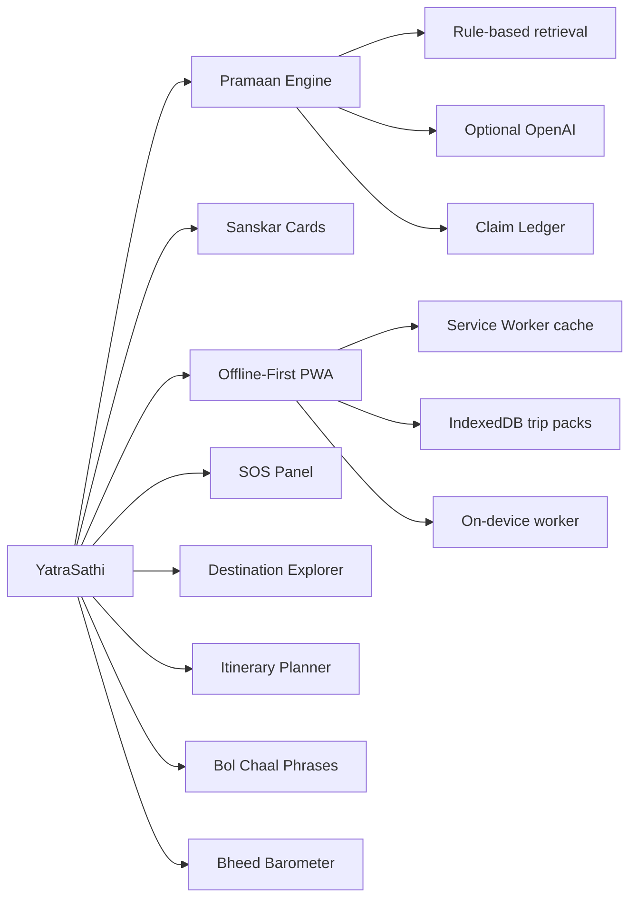
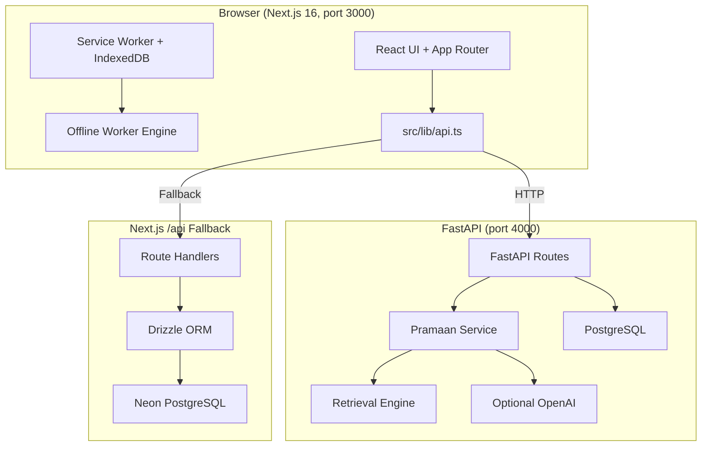
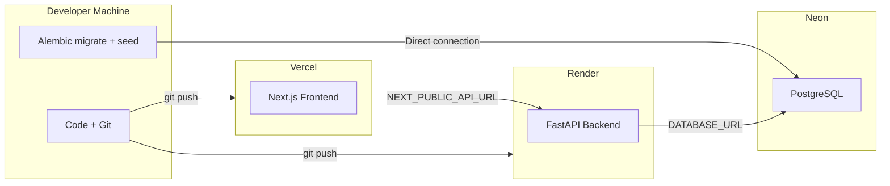

# YatraSathi — Complete Research & Handoff Document

**Prepared for:** Team Meeting / PPT Presentation  
**Date:** November 26, 2026  
**Repository:** [github.com/hsharmaharshofficialin-hash/yatraasathi](https://github.com/hsharmaharshofficialin-hash/yatraasathi)  
**Status:** Repo cleaned, committed, and pushed to GitHub

---

## 1. What is YatraSathi?

**YatraSathi** (यात्रा साथी — literally "Travel Companion") is an honest, citation-first travel companion web app for exploring India. Unlike existing travel apps that flood users with unverified recommendations, sponsored listings, and AI-generated hallucinations, YatraSathi treats **"I don't know" as a valid answer**.

**Tagline:** *Go further. Feel closer.*

### The Core Philosophy

| Principle | What it means |
|-----------|--------------|
| **Pramaan (प्रमाण)** | Every cultural/historical claim is either cited from a verified source (UNESCO, ASI, academic papers) or the system explicitly says "Unknown." No made-up facts. |
| **Sanskar (संस्कार)** | Etiquette cards at heritage sites — what to wear, photography rules, head covering norms — with verification status (verified/unverified) shown honestly. |
| **Network Honesty** | The app tells you when it's offline and labels all offline answers as "On-device, offline." No silent fallbacks pretending to be live data. |
| **Abstention over Hallucination** | Ask for restaurant ratings? The engine refuses. Ask about something outside the verified knowledge pack? It says so. |

---

## 2. Why Does YatraSathi Exist? (The Problem)

### 2.1 India's Tourism Scale

India's tourism market is massive and growing fast:

| Metric | Number |
|--------|--------|
| Domestic tourist visits | **4.28+ billion** visits (record high) |
| International tourist arrivals | **~20.22 million** (incl. NRIs) |
| Foreign exchange earnings from tourism | **~USD 31.69 billion** |
| Corporate travel market | **USD 42.9 billion** |
| UNESCO World Heritage Sites | **43 sites** |
| Indian nationals traveling abroad | **32.8+ million** |

### 2.2 The Problems YatraSathi Solves

#### Problem 1: AI Hallucination in Travel

Existing AI-powered travel tools (ChatGPT itineraries, MakeMyTrip AI, Google AI overviews) regularly:
- Invent nonexistent train routes and hotel names
- Misstate monument timings and ticket prices
- Recommend closed heritage sites with full confidence
- Default to hyper-commercialized Golden Triangle loops, ignoring regional depth

**YatraSathi's answer:** The Pramaan engine only restates facts from a verified knowledge pack. Every sentence is tagged `[VERIFIED:source]`, `[INFERRED]`, or `[UNKNOWN]`. If OpenAI is used, it's constrained to the same pack — it cannot invent.

#### Problem 2: Cultural Flattening

Travel apps flatten India's thousands of micro-cultures into stereotypical tropes. Sacred rituals become Instagram backdrops. Algorithmic bias (English-language training data, Western perspectives) means rural, tribal, and indigenous tourism is ignored or inaccurately portrayed.

**YatraSathi's answer:** Sanskar etiquette cards with per-site, per-field verification. Dress codes, photography rules, offering norms, quiet hours — each field shows verified/unverified status and the source. Unreviewed items are honestly tagged as "Unreviewed."

#### Problem 3: Connectivity Gaps

India has massive dead zones — Ladakh passes, Rajasthan deserts, rural heritage villages. Existing apps break completely offline. Travelers in emergencies can't even access basic info.

**YatraSathi's answer:** Full PWA with Service Worker caching, IndexedDB trip packs, an on-device offline retrieval engine, and queued edits that sync when connectivity returns. The UI banner clearly shows "On-device, offline" mode.

#### Problem 4: No Emergency Honesty

Travel apps either skip emergency features entirely or pretend their SOS button dispatches help. Neither is acceptable.

**YatraSathi's answer:** SOS panel with `tel:112` and on-device GPS coordinates. The app explicitly states it **does not dispatch emergency services**. It gives you the number and your location — nothing more, nothing less.

---

## 3. Feature Breakdown (PPT Slide Material)

### 3.1 Core Features

| Feature | Description | Status |
|---------|-------------|--------|
| **Pramaan Engine** | Cited-or-abstain Q&A. Every answer has a Claim Ledger showing evidence per sentence. Tap any sentence to see the source. | Working (rule-based + optional OpenAI) |
| **Claim Ledger** | Visual breakdown of every answer into Verified / Inferred / Unknown segments with linked sources | Working |
| **Arena Mode** | Side-by-side comparison: "plain" ungrounded tourist-guide claims vs Pramaan verified answers. Unsupported sentences highlighted in the plain column. | Working |
| **Sanskar Cards** | Per-site etiquette: footwear, head covering, photography, gendered access, non-adherent entry, offering norms, quiet hours. Each field shows verification status + source + date. | Working |
| **"I'm Here" Geofence** | ~150m geofence triggers the Sanskar card automatically when you arrive at a heritage site | Working |
| **Offline Mode** | Service Worker + IndexedDB. Cache maps, stories, cards, phrases. Web Worker runs retrieval over the cached pack. Banner shows "On-device, offline" | Working |
| **SOS Panel** | `tel:112`, on-device GPS coordinates. No dispatch claims. | Working |
| **Bol Chaal (बोल चाल)** | Travel phrases in local languages with pronunciation | Designed screen |
| **Bheed Barometer (भीड़)** | Crowd density indicators. GI registry rows are real facts; licensed-guide and homestay data is mock | Designed screen |
| **Vichaar Ledger (विचार)** | Community feedback and verification ledger | Designed screen |
| **Overpass Services** | Live OSM data for toilets, water, hospitals. If Overpass is silent, UI says "unknown" — not "no toilets" | Working |
| **i18n / Multilingual** | Hindi + English with Devanagari font support. Locale strings in TypeScript modules. | Working |

### 3.2 What YatraSathi Explicitly Refuses

| Request | Response |
|---------|----------|
| "Best restaurants near Amer Fort?" | **Abstains.** "Unknown" — YatraSathi does not do ratings or restaurant lists. |
| "Rate this hotel" | **Refused.** Unknown is valid. |
| Unverified historical claims | Tagged as `[UNKNOWN]` with reason: "Not in the verified knowledge pack." |

This is a feature, not a bug. The app earns trust by being honest about what it doesn't know.

---

## 4. Destinations Covered (Current Build — 20 Sites)

| # | Destination | State/Region | Cultural Highlight |
|---|------------|-------------|-------------------|
| 1 | Taj Mahal | Agra, UP | Nawabi adab, Urdu shayari |
| 2 | Amer & Pink City | Jaipur, Rajasthan | Ghoomar dance, block printing |
| 3 | Red Fort | Delhi | Mughal court heritage, qawwali |
| 4 | Qutub Minar | Delhi | Delhi Sultanate history |
| 5 | Varanasi | UP | Ganga aarti, classical music |
| 6 | Golden Temple | Amritsar, Punjab | Seva, kirtan, bhangra |
| 7 | Kerala Backwaters | Alleppey, Kerala | Kathakali, snake boat races |
| 8 | Mysore Palace | Karnataka | Dasara, Yakshagana |
| 9 | Hampi | Karnataka | Vijayanagara ruins |
| 10 | Khajuraho | MP | Chandela art, dance festival |
| 11 | Ajanta & Ellora | Maharashtra | Rock-cut caves |
| 12 | Gateway & Mumbai | Maharashtra | Bollywood, dabbawalas |
| 13 | Goa | Goa | Carnival, Konkani mando |
| 14 | Konark Sun Temple | Odisha | Odissi dance, Rath Yatra |
| 15 | Meenakshi Temple | Madurai, TN | Bharatanatyam, Chithirai |
| 16 | Jaisalmer & Thar | Rajasthan | Camel safaris, Kalbelia |
| 17 | Udaipur | Rajasthan | Miniature painting, Gangaur |
| 18 | Ladakh & Pangong | Ladakh | Hemis festival, cham dance |
| 19 | Kashmir | Srinagar | Wazwan, Sufi music |
| 20 | Rishikesh & Haridwar | Uttarakhand | Yoga, Kumbh Mela |

Each destination includes: local dish, traditional dress, cultural highlight, color theme, and icon.

---

## 5. Technical Architecture

### Tech Stack

| Layer | Technology |
|-------|-----------|
| Frontend Framework | Next.js 16 (App Router) |
| UI | React 19, Tailwind CSS 4, custom CSS modules |
| Fonts | Cinzel (display), Inter (sans), Noto Serif Devanagari |
| State/Data | TypeScript data modules (not JSON files) |
| Database (frontend fallback) | Drizzle ORM + PostgreSQL (Neon) |
| Backend API | FastAPI (Python 3.12) + SQLAlchemy + Alembic |
| Database (backend) | PostgreSQL (Neon) |
| Offline | Service Worker, IndexedDB, Web Worker |
| Hosting | Frontend: Vercel, Backend: Render (or Railway) |
| AI (optional) | OpenAI GPT-4o-mini (constrained to verified pack) |

### Key Design Decisions

1. **Frontend and backend never import each other.** They communicate over HTTP only. `src/lib/api.ts` is the single module that reads the wire format.
2. **No JSON data files.** All seed data lives in Python modules (backend) and TypeScript modules (frontend). Locale strings live in `src/data/locales.ts`.
3. **The Next.js `/api` routes auto-seed** the database if empty, so the preview works without the Python backend.
4. **LLM is optional.** Without `OPENAI_API_KEY`, the system runs entirely on rule-based retrieval. With a key, OpenAI is constrained to only restate facts from the verified pack.

---

## 6. Competitive Analysis

### How YatraSathi Differs from Existing Players

| Dimension | MakeMyTrip | TripAdvisor | Google Travel | YatraSathi |
|-----------|-----------|-------------|---------------|------------|
| **Primary purpose** | Book flights/hotels/trains | Reviews and meta-search | AI-generated itineraries | Verified cultural companion |
| **Revenue model** | Commissions, ads, fintech | CPC referrals, ads | Ecosystem lock-in | None (open source) |
| **Cultural depth** | Minimal — focused on transactions | User-generated reviews (variable quality) | AI-generated (hallucination-prone) | Cited sources, Sanskar cards, honest unknowns |
| **Offline support** | Partial (boarding passes) | Minimal | Google Maps offline tiles | Full PWA — content, Q&A, SOS all work offline |
| **Honesty about unknowns** | N/A | N/A (reviews may be fake) | AI confidently wrong | Abstains when unsure, tags unknowns explicitly |
| **Heritage etiquette** | None | Sporadic user tips | None | Structured, verified, per-field etiquette cards |
| **Emergency features** | None | None | Basic hospital search | SOS with GPS + honest "no dispatch" disclaimer |
| **Language support** | Hindi/English + others | English-heavy | Multilingual | Hindi/English with Devanagari, expandable |
| **Target user** | Booker (transaction stage) | Researcher (inspiration stage) | Planner (itinerary stage) | On-ground traveler (experience stage) |

### YatraSathi's Unique Position

YatraSathi does NOT compete with booking platforms. It fills the gap that exists **after you've booked and before/during your actual trip** — the "on-ground companion" space where:
- You need cultural context, not hotel prices
- You need etiquette guidance, not restaurant ratings
- You need verified history, not AI-generated fluff
- You need offline reliability, not cloud-dependent maps

---

## 7. Market Opportunity (PPT Data Points)

### India Tourism at a Glance

- India's travel tech market: **USD 400+ million** base, scaling aggressively
- Domestic tourism: **4.28 billion visits** (record high)
- 43 UNESCO World Heritage Sites with growing digital preservation needs
- Government schemes like PRASHAD and Swadesh Darshan invest billions in heritage tourism infrastructure
- Outbound travel from India: **32.8+ million departures** — these travelers also need cultural prep

### The Gap YatraSathi Fills

1. **No existing app does "cited cultural narratives" at heritage sites.** Tourist guides are unverified. Google gives AI hallucinations. Guidebooks go stale.
2. **Offline-first cultural apps don't exist for India.** India has significant dead zones at the very places tourists visit (Ladakh, Thar, Hampi ruins, remote temples).
3. **Etiquette information is scattered.** Temple dress codes, photography rules, prayer-time quiet hours — this data lives in blog posts and word-of-mouth, not in a structured, verified format.
4. **AI trust problem is real.** Consumer backlash against AI-generated travel advice is documented and growing. YatraSathi's "abstain over hallucinate" approach is a trust differentiator.

---

## 8. Demo Flow (For the Meeting)

Walk through this sequence to show the full product story:

| Step | Action | What it proves |
|------|--------|---------------|
| 1 | Open `/` | Cinematic homepage with 20 destinations, trip readiness, travel toolkit |
| 2 | Cache the trip pack | Tap "Pack & Go" — download maps, stories, cards, phrases for offline use |
| 3 | Open Amer Fort page | Destination detail with cultural info, dish, dress, local customs |
| 4 | Tap "I'm here" | Sanskar card appears with 7 etiquette fields, sources, verification dates |
| 5 | Go to `/ask` | Ask a UNESCO question — answer comes back with Claim Ledger |
| 6 | Tap a sentence in the answer | See the evidence: source title, publisher, URL, verification date |
| 7 | Ask for restaurant ratings | The engine abstains — shows "Unknown" |
| 8 | Go to `/arena` | Side-by-side: plain ungrounded claims vs Pramaan verified. Unsupported sentences highlighted. |
| 9 | Turn on Airplane Mode | Banner switches to "On-device, offline" |
| 10 | Go to `/demo` | Preset questions still work from the cached pack |
| 11 | Open `/sos` | Emergency panel with tel:112 and GPS coordinates |

---

## 9. Deployment Architecture

| Service | Platform | Cost |
|---------|----------|------|
| Frontend | Vercel | Free tier |
| Backend | Render (or Railway) | Free tier (sleeps after idle) |
| Database | Neon PostgreSQL | Free tier |
| DNS/Domain | Optional | Variable |

> [!IMPORTANT]
> Free-tier Render services sleep after idle. Open `/health` a few minutes before any demo to wake the backend.

---

## 10. Roadmap & Future Scope

| Phase | Features | Priority |
|-------|----------|----------|
| **Now** | Jaipur trip pack, 20 destinations, Pramaan + Sanskar + Offline + SOS | Shipped |
| **Next** | More city packs (Varanasi, Delhi, Kerala), Bol Chaal phrase audio, Bheed Barometer live crowd data | High |
| **Later** | On-device neural model (WebLLM) for fully offline Q&A, community-verified data submission, regional language expansion (Tamil, Kannada, Malayalam, Bengali) | Medium |
| **Vision** | Verified cultural companion for every heritage site in India — an open, honest alternative to AI-generated travel misinformation | Long-term |

---

## 11. Key Talking Points for the Meeting

1. **YatraSathi is not a booking app.** It's a cultural companion. It lives in the gap between "I booked my ticket" and "I'm standing at a temple wondering what the rules are."

2. **The trust angle is the differentiator.** In a world where AI confidently invents train routes and hotel names, YatraSathi explicitly says "I don't know" when it doesn't know. That honesty is the product.

3. **Offline-first is not optional for India.** The places tourists actually visit — Ladakh, Thar, Hampi, remote temples — are the places with the worst connectivity. An app that breaks offline is useless at the moment of truth.

4. **Heritage etiquette is a real need.** No existing app tells you in a structured way: "Remove footwear before entering. Photography is not allowed inside the sanctum. This information was verified by [source] on [date]."

5. **The tech is production-ready.** Next.js 16, FastAPI, PostgreSQL, PWA with Service Worker — standard, scalable, deployable on free tiers today.

6. **The market timing is right.** 4.28 billion domestic visits, growing cultural tourism, government investment in heritage, and rising backlash against AI-generated travel advice.

---

## 12. Repository Status

| Item | Status |
|------|--------|
| GitHub repo | [github.com/hsharmaharshofficialin-hash/yatraasathi](https://github.com/hsharmaharshofficialin-hash/yatraasathi) |
| Branch | `main` |
| Last commit | `9014c1a` — "Clean up deleted backend files and update requirements" |
| `.env` files | Gitignored (never committed) |
| `.bak` files | Gitignored |
| Backend status | Deleted files cleaned up and committed. `requirements.txt` updated. |
| Frontend status | Running on Next.js 16 with Webpack (Turbopack not supported on this platform) |
| Local dev | `npx next dev --webpack` on port 3000 |

---

*This document is the complete handoff for anyone picking up YatraSathi. Read the [README.md](https://github.com/hsharmaharshofficialin-hash/yatraasathi/blob/main/README.md) in the repo for local setup commands, and [DEPLOY.md](https://github.com/hsharmaharshofficialin-hash/yatraasathi/blob/main/DEPLOY.md) for Vercel + Render deployment steps.*
